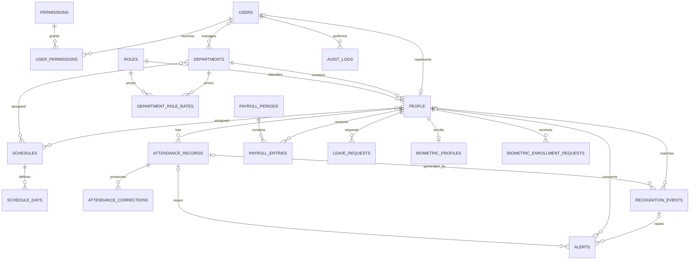

# Database Design

## Core tables

| Table | Purpose and important indexes |
| --- | --- |
| `users` | Admin and regular accounts; unique email, indexed role/status/last login, soft deletes |
| `permissions`, `user_permissions` | Central permission catalog and explicit Admin assignments |
| `personal_access_tokens` | Sanctum tokens for users and mobile devices |
| `people` | Tracked employees/students/staff; unique person code/email, indexed department/type/status/face state, soft deletes |
| `departments` | Organizational groups with manager and status, soft deletes |
| `roles`, `department_role_rates` | Employee roles and non-overlapping historical hourly rates per department |
| `schedules`, `schedule_days` | Work windows, grace periods, active weekdays |
| `person_schedule`, `department_schedule` | Individual and group schedule assignments |
| `holidays` | Global or department-specific non-working dates |
| `attendance_records` | One row per person/date; check-in/out, computed status, verification metadata, soft deletes |
| `attendance_corrections` | Immutable before/requested values and review history |
| `leave_requests` | Date range, review state, and reviewer |
| `biometric_profiles` | Enrollment/consent state and hidden secure reference; no dashboard embedding field |
| `biometric_enrollment_sessions` | Supervised enrollment attempt state, actor, model version, and safe processing result |
| `face_samples` | Three encrypted private-path references for front, left, and right enrollment samples |
| `biometric_enrollment_requests` | Hashed, expiring, single-use mobile enrollment tokens |
| `mobile_devices` | Dedicated kiosk identities and hashed secrets, soft deletes |
| `recognition_events` | Unique event UUID, confidence/liveness/result, source, time, verification state |
| `alerts` | Administrative recognition/attendance alerts and resolution state |
| `payroll_periods`, `payroll_entries` | Monthly calculation state and immutable employee/rate/attendance snapshots |
| `notifications` | Laravel database notifications |
| `audit_logs` | Append-only security and change history |
| `settings` | Typed, grouped database configuration |
| `jobs`, `failed_jobs`, `job_batches` | Queue persistence |

## Relationships

## Integrity rules

- Foreign keys protect references; historical attendance and recognition restrict or null parent deletion rather than cascading.
- `(person_id, attendance_date)` is unique, and `event_uuid` is unique for mobile idempotency.
- Prefixed public identifiers (`EMP-*`, `EVT-*`, `REC-*`, `ALT-*`, `LR-*`) are unique and used for route binding where the React UI already expects them.
- Common filters are indexed: email, person code, department, person, attendance date/status, recognition occurrence/status, event UUID, alert status/severity, role, and account status.
- People, users, departments, mobile devices, and attendance use soft deletion where restoring or auditing history matters.
